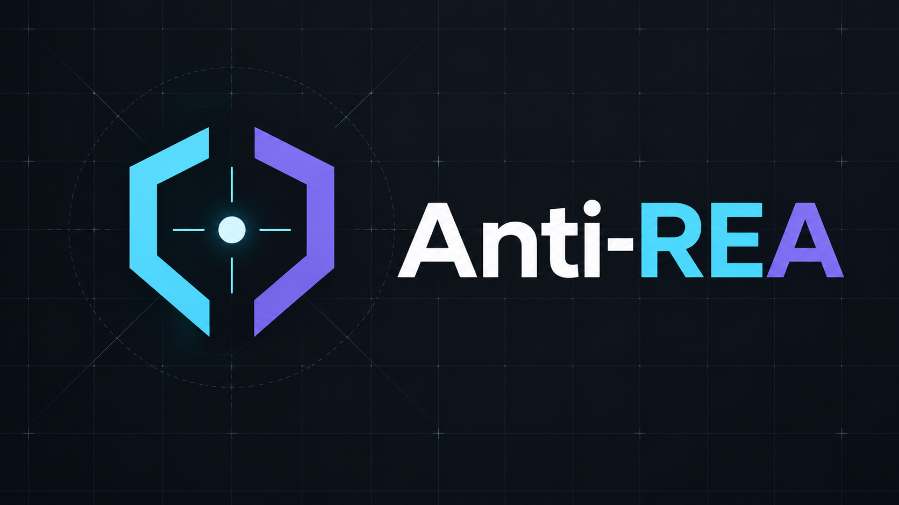
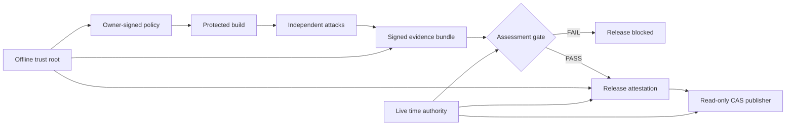

# Anti-REA

**English | [Русский](README.ru.md)**



[](https://github.com/neuratechcompany-ops/anti-rea/actions/workflows/ci.yml)
[](https://nodejs.org/)
[](LICENSE)
[](#verification)

**Evidence-driven protection against AI-assisted reverse engineering.**

Anti-REA turns software protection from a collection of opaque obfuscator
settings into a verifiable process: precommit the threat model, attack the
unprotected artifact, apply countermeasures, repeat the attacks, and permit a
release only when reproducible signed evidence satisfies the owner's policy.

> Anti-REA does not claim that client-delivered code can be made impossible to
> recover. Its purpose is to keep actual secrets off the client, measurably
> increase analysis cost, and prevent an agent or CI job from declaring success
> without evidence.

[Capabilities](#capabilities) · [Quick start](#quick-start) ·
[Architecture](#architecture) · [Threat model](references/adaptive-rea-threat-map.md) ·
[Command reference](references/framework-commands.md) ·
[Contributing](CONTRIBUTING.md) · [Security](SECURITY.md)

## Architecture



The owner signs policy and thresholds before analysis. Independent workers run
the required attacks and sign their exact raw evidence. The assessment gate
reopens every referenced artifact, recomputes hashes, enforces freshness and
one-time challenges, and produces a separately signed PASS or FAIL result.
Provenance, release attestation, and the CAS publisher bind that result to the
exact bytes that are released.

## Capabilities

- static, dynamic, structural, and semantic recovery probes;
- runtime interception after legitimate external-key provisioning;
- cross-build alignment over 20–64 independently diversified variants;
- behavioral equivalence checks against a private holdout corpus;
- JavaScript/Electron, web, WASM, native, .NET, and Android guidance;
- release, update, crash, support, and symbol delivery-surface inspection;
- owner-signed policies that prevent post-result threshold weakening;
- root-signed role bundles with key separation and scope enforcement;
- worker, coordinator, builder, server, manifest, gate, release, and publisher
  attestations;
- installed dependency-closure verification against the lockfile and policy;
- live-challenged external time authority with replay-resistant nonce
  consumption;
- fail-closed release-chain validation, rollback protection, and read-only
  content-addressed publication;
- explicit residual-risk reporting instead of absolute security claims.

## Quick start

Requirements: Node.js 20 or newer.

```bash
git clone https://github.com/neuratechcompany-ops/anti-rea.git
cd anti-rea
npm ci
npm test
```

For an agent-driven workflow, install or reference `SKILL.md` together with the
`references/` directory. The mandatory workflow is:

1. classify every protected fact as `SERVER_REQUIRED`, `PUBLIC`, or
   `COST_ONLY`;
2. define the attacker tier and owner-signed acceptance thresholds;
3. collect baseline recovery evidence;
4. apply only controls that match the declared claim;
5. rerun independent static, runtime, semantic, and regression probes;
6. issue provenance and release attestations only for an evidence-backed PASS;
7. publish the exact attested bytes through the CAS publisher.

The complete operational sequence and command examples are documented in
[`references/framework-commands.md`](references/framework-commands.md).

## Core components

| Component | Purpose |
|---|---|
| `SKILL.md` | Mandatory agent workflow and completion criteria |
| `references/agent-playbook.md` | Evidence collection and iteration protocol |
| `references/adaptive-rea-threat-map.md` | Threat model for an adaptive REA that knows this framework |
| `references/rea-breakout-map.md` | Attacker-win tree and regression backlog |
| `scripts/protection-policy.mjs` | Owner-signed precommit of claims, attacks, tools, and thresholds |
| `scripts/validate-assessment.mjs` | Machine-verifiable before/after assessment gate |
| `scripts/probe-vm-runtime.mjs` | Runtime plaintext-observation probe |
| `scripts/probe-behavior-holdout.mjs` | Hash-only behavioral equivalence oracle |
| `scripts/probe-cross-build-semantic.mjs` | Cross-build semantic IR alignment attack |
| `scripts/delivery-graph.mjs` | Complete release/update/crash/support/symbol inventory |
| `scripts/create-provenance.mjs` | Product source, build, toolchain, and evidence binding |
| `scripts/release-attestation.mjs` | Signed, expiring, anti-rollback release chain |
| `scripts/cas-publish.mjs` | Verification of copied bytes and read-only digest-addressed publication |
| `scripts/time-attestation.mjs` | Live external time challenge and one-time ledger |
| `scripts/dependency-closure.mjs` | Installed protector dependency-tree verification |

## Security model

The strongest rule is architectural: anything that must remain secret or
authoritative must remain server-side. Client-side controls are used to reduce
incidental leakage and raise the cost of recovering `COST_ONLY` logic. They do
not turn a hostile client into a trusted environment.

Anti-REA explicitly models an attacker who:

- knows the complete framework implementation;
- modifies or replaces analyzers and build inputs;
- observes runtime plaintext and inter-process boundaries;
- compares many chosen-input builds;
- attempts to forge, omit, replay, or downgrade evidence;
- attacks the release process rather than only the protected artifact.

For production claims, the pinned trust root, signer keys, append-only ledgers,
analysis-worker isolation, HSM/KMS policy, and WORM storage must be enforced
outside the repository. See [`SECURITY.md`](SECURITY.md) and the
[`breakout map`](references/rea-breakout-map.md).

## Verification

```bash
npm ci
npm test
npm audit --omit=dev
node scripts/check-secret-scanner.mjs
gitleaks git . --config .gitleaks.toml --log-opts=--all --redact --ignore-gitleaks-allow
```

Current baseline: **209/209 tests passing** on Node.js 20 and 22. CI also runs
npm audit and Gitleaks. A green project CI run confirms framework integrity; it
does not by itself prove that a particular downstream product is protected.
Each product claim requires its own signed evidence bundle and declared attacker
tier. The secret scanner is tested against controlled synthetic credentials in
both application and test paths, so a disabled rule set cannot pass unnoticed.
Use Gitleaks 8.30.1, the version pinned in CI.

Version 0.34.1 re-hashes the copied CAS payload before publication and checks
stored bytes even on idempotent retries. It also fixes the previous secret-scan
configuration, which could return a clean result without loading detection
rules, and bounds live time clients even when they ignore SIGTERM or leave
descendant pipes open. See the [security changes](CHANGELOG.md#0341---2026-10-23).

## Project status and limitations

Anti-REA is under active `0.x` development. Evidence and attestation formats may
change between minor releases. A fully controlled client runtime can observe
logic after decryption. Remote signing, non-exportable keys, durable one-time
state, isolated analysis workers, and immutable storage remain deployment
responsibilities.

The repository currently contains detailed Russian-language operational
references in addition to this English overview. Contributions translating the
deeper reference material are welcome, provided security terminology and
fail-closed requirements are preserved exactly.

## Author and license

Created and maintained by **Aurum Veikko Kettunen**.

Licensed under the [GNU Affero General Public License v3.0](LICENSE). See
[`CONTRIBUTING.md`](CONTRIBUTING.md), [`SECURITY.md`](SECURITY.md), and
[`CODE_OF_CONDUCT.md`](CODE_OF_CONDUCT.md).
