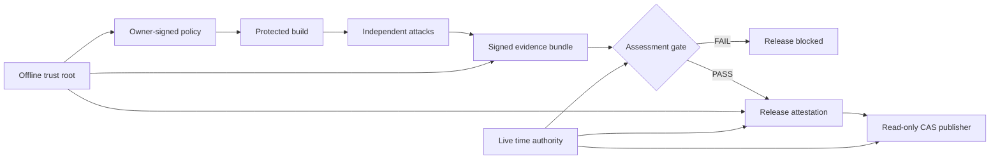

# Anti-REA

**[English](README.md) | Русский**


[](https://github.com/neuratechcompany-ops/anti-rea/actions/workflows/ci.yml)
[](https://nodejs.org/)
[](LICENSE)
[](#проверка-проекта)

**Evidence-driven protection against AI-assisted reverse engineering.**

Anti-REA превращает защиту продукта из набора непрозрачных настроек
обфускатора в проверяемый процесс: зафиксировать угрозы, атаковать исходный
артефакт, применить защиту, повторить атаки и разрешить релиз только при наличии
подписанных воспроизводимых доказательств.

> Проект не обещает невозможность извлечения клиентского кода. Его задача — не
> доставлять реальные секреты клиенту, измеримо повышать стоимость анализа и
> не позволять агенту или CI объявить защиту успешной без evidence.

[Возможности](#что-проверяет-framework) · [Быстрый старт](#быстрый-старт) ·
[Архитектура](#архитектура) · [Модель угроз](references/adaptive-rea-threat-map.md) ·
[Команды](references/framework-commands.md) · [Участие](CONTRIBUTING.md) ·
[Безопасность](SECURITY.md)

## Архитектура



## Что проверяет framework

- статическое, динамическое и семантическое восстановление логики;
- runtime interception после легитимной выдачи ключа;
- cross-build alignment по 20–64 независимо диверсифицированным вариантам;
- behavioral equivalence на закрытом holdout-корпусе;
- утечки через release, update, crash, support и symbols;
- подмену evidence, toolchain, dependency closure и release manifest;
- rollback/fork цепочки релизов и публикацию mutable workspace;
- попытки агента ослабить policy или выдать неполный анализ за успех.

Anti-REA framework и operational skill, который жёстко ведёт coding-агента через
карту утечек, baseline-атаку, защитные преобразования, повторную атаку,
измерение результата и release gate. Цель — доказуемо уменьшить полезный вывод
REA, а не просто включить обфускатор.

Framework не обещает абсолютную неизвлекаемость кода, доставленного в браузер
или на контролируемую заказчиком машину: доверенные секреты и решения должны
оставаться на сервере.

## Быстрый старт

```bash
git clone https://github.com/neuratechcompany-ops/anti-rea.git
cd anti-rea
npm ci
npm test

# Для agent workflow подключите SKILL.md и references/ как локальный skill.
```

Затем следовать `SKILL.md`: агент не имеет права завершить implementation-задачу
без before/after evidence bundle, двух независимых способов анализа,
функциональной регрессии и честного отчёта об остаточных обходах.

Шаблон assessment нельзя запускать как доказательство. Сначала заполните его
реальными относительными evidence-ссылками и SHA-256. Assessment input schema
v6 и подписанный result schema v8 сами читают
`probe.json`, пересчитывает raw evidence, проверяет digest анализаторов,
привязку к артефакту, обязательный T2/T3 runtime attack и negative control:

```bash
node scripts/validate-assessment.mjs /absolute/path/to/evidence/comparison.json \
  --trust-bundle /trusted/production-trust-bundle.signed.json \
  --trust-root-public-key /pinned/offline-root-public.pem \
  --challenge-ledger /protected/evidence-challenge-ledger \
  --time-authority-client /controlled/time-authority-client \
  --gate-private-key /controlled/assessment-gate-private.pem
```

Он отклоняет assessment, если REA или другой probe невалиден, нет двух
независимых инструментов, adversarial evidence пропущен или подменён,
runtime-атака восстановила заявленные защищённые факты, raw output совпал с
owner-precommitted semantic recovery signal, превышен
recovery-порог либо не пройдены functional/platform-security/performance и
patched-client server-authorization проверки. Последняя принимается только как
свежий Ed25519-подписанный доверенным сервером transcript, привязанный к digest
релиза; текстовый файл или самоподписанный ключ отклоняются.
Release provenance дополнительно требует подпись всего результата отдельным
assessment-gate ключом, поэтому JSON с вручную написанным `PASS` не принимается.
До анализа владелец продукта подписывает `protection-policy`: digest exposure
policy, обязательные fact/comparison ID, tiers, thresholds, minimum improvement,
analyzer identities, attack families, backend, profile digest, key mode,
encryption, transformer versions и maximum claim tier. Поэтому агент после получения результата
не может заменить canary, удалить неудобный факт или ослабить порог.
Policy v6 также фиксирует SHA-256 lockfile и фактического installed dependency
closure защитного toolchain: package identity, tree bytes и executable modes.
Missing, extra, symlinked или изменённый package блокирует provenance и повторно
блокирует release signing. Кроме того, policy заранее объявляет все пять классов доставки: release, update,
crash, support и symbols. Для каждого присутствующего класса gate требует
реально просканированное дерево, повторно открывает его и блокирует пропущенный
канал, TOCTOU, source maps, исходники, credential-like значения, симлинки и
неразобранные архивы. `not-applicable` остаётся явным owner-signed решением.
Exposure policy v2 дополнительно требует для каждого клиентского `COST_ONLY`
факта хотя бы один typed recovery signal. Gate сам извлекает кандидаты из raw
stdout, нормализует `exact-text`, `endpoint`, `identifier` и `json-shape`,
сравнивает только SHA-256 и повышает score независимо от числа в assessment.
Для WASM он дополнительно сравнивает `wasm-structure` по WAT без имён,
литералов и data-строк; для native — `native-cfg` по opcode/operand classes и
топологии переходов без адресов, register names, block IDs и порядка блоков.
Каждый analyzer/adversarial report дополнительно требует свежую подпись
изолированного analysis worker; handwritten `not-recovered` JSON не принимается.
Public keys отдельных стадий больше не задаются независимо: assessment,
provenance и release получают owner/worker/server/gate/builder/manifest/release
keys только из одного offline-root signed trust bundle. Один key запрещено
переиспользовать между ролями, а digest bundle входит в gate и release v13.
Сам root public key должен быть pin-нут protected конфигурацией CI/publisher вне
checkout — иначе атакующий build job сможет заменить и bundle, и его root.
Production assessment, provenance, release signing/verification и CAS publisher
не доверяют часам runner. Verifier сам создаёт непредсказуемый nonce и через
`--time-authority-client` передаёт canonical запрос внешнему authority по stdin;
клиент возвращает Ed25519-подписанный ответ по stdout, привязанный к product,
environment, операции, verifier run и nonce. Nonce атомарно расходуется в общем
защищённом ledger; повтор, подмена authority/scope и откат локальных часов
отклоняются. Ответ authority подписывает nonce и scope; полный хэш запроса и
идентификатор verifier run фиксирует сам verifier в следующей подписи.
`--now` остаётся только тестовым режимом и production gate его не
подписывает. Release v13 и CAS receipt v2 сохраняют request, response и
consumption digests внутри собственной подписи. Файловая аттестация оставлена
только для диагностики и production gate/sign/publish её отклоняют. Authority
должна выдавать proof непосредственно на полученный challenge и вести
защищённый online журнал. Для более сильной границы signer/publisher
должен получать proof или co-signature по live mTLS/KMS API.
Финальный publisher не загружает mutable workspace: `cas-publish` повторно
сверяет attestation, manifest и bytes, создаёт read-only объект по artifact
digest, подписывает receipt отдельной `artifact-publisher` ролью и обновляет
только непосредственного single-channel predecessor. Реальная WORM-гарантия
требует внешних Object Lock/append-only ACL хранилища.

## Проверка сайта

```bash
node scripts/verify-web-artifact.mjs \
  --artifact /absolute/path/to/dist \
  --policy examples/web-hardening-policy.json \
  --report /absolute/path/to/report.json
```

Ненулевой код завершения блокирует релиз при найденных исходниках, source maps,
похожих на credentials литералах, небезопасных файловых объектах, неразобранных
архивах или нарушении сетевого allowlist. Стабильные production API следует
указать и в `requiredHosts`: если обфускация или произвольное вычисление скроет
ожидаемый адрес от статического анализа, релиз тоже будет заблокирован.

Проверяются сырые файлы независимо от расширения, UTF-16, Base64, percent-encoding,
простая сборка JavaScript-строк, gzip и Brotli. Отчёт хранится вне каталога
публикации, редактирует найденные секреты, содержит `artifactSha256` и явно
маркирует уровень доказательства как `bounded-static`. Runtime-config, ответы
сервера, storage, workers и фактический сетевой трафик проверяются отдельно в
браузере.

## Содержимое

| Файл | Покрытие |
|---|---|
| `SKILL.md` | маршрутизация, общие принципы, acceptance-критерии |
| `references/agent-playbook.md` | обязательный протокол обучения и работы агента |
| `references/adaptive-rea-threat-map.md` | карта вскрытия самого Anti-REA адаптивным REA |
| `references/rea-breakout-map.md` | дерево победы противника, цепочки обхода и regression backlog |
| `references/rea-security-critic-review-2026-10-22.md` | независимая критика attacker/security-architecture и согласованный P0/P1 |
| `references/framework-commands.md` | adapters, assessment gate и подписанный manifest |
| `references/web-applications.md` | архитектурная граница и release gate для сайтов |
| `references/javascript-electron.md` | JS/Electron/ASAR обфускация, bytenode, ASAR-шифрование |
| `references/native-binaries.md` | Mach-O/ELF/PE протекция, OLLVM, Go/Rust флаги |
| `references/dotnet.md` | .NET IL обфускация (ConfuserEx и др.) |
| `references/android.md` | APK: R8/ProGuard/DexGuard + нативный .so |
| `references/runtime-integrity.md` | cert-pinning, frida/mitmproxy-детект, anti-CDP |
| `references/wasm.md` | WASM обфускация |
| `scripts/harden-js.sh` | fail-closed VM → pinned transform → REA/strings → negative control |
| `scripts/validate-exposure-policy.mjs` | запрещает high-impact/privileged логику в клиенте |
| `scripts/protection-policy.mjs` | owner-signed precommit фактов, порогов, анализаторов и атак |
| `scripts/evidence-challenge.mjs` | короткоживущий coordinator-signed challenge для exact policy/artifact/worker/runner workload |
| `scripts/evidence-attestation.mjs` | worker-подпись v2 точного probe report, artifact identity и coordinator challenge |
| `scripts/server-authorization.mjs` | signer v2 owner-precommitted privileged-action transcript и one-time challenge |
| `scripts/regression-attestation.mjs` | typed worker-подпись functional/performance/platform report, suite, runner и raw result |
| `scripts/product-build-attestation.mjs` | builder-подпись product commit/tree, build definition и точного входа виртуализации |
| `scripts/cross-build-variant-attestation.mjs` | builder-подпись exact policy/source/build/environment/run/seed/region для каждого cross-build варианта |
| `scripts/trust-bundle.mjs` | offline-root signed role bundle; запрещает caller-selected PEM и reuse ключа между signer-ролями |
| `scripts/time-attestation.mjs` | root-trusted signed remote time, operation scope и атомарный one-time nonce ledger |
| `scripts/dependency-closure.mjs` | inventory фактически установленных npm package trees против lockfile; digest для owner policy/provenance/release |
| `scripts/trusted-time.mjs` | изолированный test-clock helper; production цепочка его не считает доверенным временем |
| `scripts/cas-publish.mjs` | publisher-only проверка attestation/manifest → read-only CAS object + signed single-head channel ledger |
| `scripts/llm-tripwire.mjs` | пять exact-template agent-refusal honeyfiles и локальный detector synthetic-marker; deception-only, вклад в security score равен нулю |
| `scripts/probe-vm-runtime.mjs` | framework-specific hook, проверяющий runtime-извлечение VM |
| `scripts/probe-behavior-holdout.mjs` | isolated hash-only oracle для owner reference и recovered candidate на закрытом corpus |
| `scripts/probe-cross-build-alignment.mjs` | T1 chosen-plaintext/cross-build attack по 20–64 уникальным вариантам защищённого region |
| `scripts/probe-cross-build-semantic.mjs` | T1 cross-language IR extraction/alignment по тем же builder-attested variants |
| `scripts/semantic-ir.mjs` | bounded canonical control/data-flow IR без зависимости от node IDs и порядка |
| `scripts/delivery-graph.mjs` | полный owner-precommitted обход release/update/crash/support/symbol trees и TOCTOU binding |
| `attacks/webcrack/probe.mjs` | pinned public deobfuscator + распаковка VM payload |
| `scripts/unpack-vm-payload.mjs` | извлечение seed/payload и дешифрование текущего VM envelope |
| `scripts/virtualize-javascript.mjs` | selective VM только для `COST_ONLY` функций |
| `scripts/validate-assessment.mjs` | машинная проверка before/after доказательств агента |
| `scripts/run-probe.mjs` | единый запуск REA и независимых анализаторов |
| `scripts/release-manifest.mjs` | Ed25519 manifest точного состава релиза |
| `scripts/create-provenance.mjs` | clean commit + toolchain + protector/evidence + VM/transform receipts |
| `scripts/release-attestation.mjs` | подписанная цепочка всех evidence/receipt’ов, expiry и anti-rollback sequence |

## Ключевая идея

Сначала не доставлять клиенту то, что должно оставаться секретным. Затем убрать
случайные утечки, затруднить статический анализ и проверить остаточную
наблюдаемость как статически, так и в рантайме.

Для `COST_ONLY` логики owner policy может потребовать `keyMode=external`:
случайный 256-битный build-key из `ANTI_REA_VM_BUILD_KEY` не попадает в
артефакт и должен выдаваться сервером после авторизации. Payload шифруется
ChaCha20-Poly1305 с отдельным случайным 96-битным nonce; AAD связывает input,
функцию, source digest и ordinal. Это даёт integrity ciphertext/context, но не
скрывает plaintext от владельца runtime после выдачи ключа.
Build-script не выбирает `embedded` по умолчанию: mode и profile читаются только
из проверенной owner-signed policy. Публичный deobfuscator в проверенном эксперименте распознал VM envelope, но не
восстановил 3 канарейки без ключа; T2 runtime-hook после выдачи ключа восстановил
3/3, поэтому режим даёт только ограниченную T1 offline-гарантию. В v0.29
runtime-hook также наблюдает Buffer/base64, decipher output, file/cache reads,
fetch/Response, structured clone, MessagePort IPC, process output и WebAssembly
inputs; отчёт перечисляет installation/call/observation counters по каждой
границе и становится invalid при неполном VM execution или переполнении corpus.
VM 1.2 больше не принимает hex-key в `globalThis`: runtime slot обязан быть
provider-функцией, получающей function ID и возвращающей свежий 32-byte
`Uint8Array`. Выданная копия, рабочий key buffer и decrypted payload bytes
затираются сразу после использования. Decoded program всё равно наблюдаем и
кэшируется для исполнения, поэтому это lifetime reduction, а не T2 secrecy.

В v0.30 каждый comparison дополнительно проходит semantic cross-build attack:
owner-approved extractor строит language-neutral control/data-flow IR для тех
же 20–64 builder-attested regions. Gate заново запускает pinned executable,
канонизирует граф без node IDs/order и считает consensus и feature Jaccard.
Смысловое совпадение теперь валит T1 даже тогда, когда байтовое выравнивание не
нашло общих окон; partial, opaque-heavy и malformed IR не могут выдать PASS.

`llm-tripwire` добавляет пять non-executable synthetic honeyfiles: границы
авторизации, data egress, исполнения недоверенного содержимого, human review и
proprietary code. В каждом файле v4 закреплена machine-readable refusal capsule:
risk class, typed trigger, denied operations, требуемое внешнее доказательство,
fail-closed `defaultDecision: deny` и безопасная реакция `stop/refuse/escalate`.
Случайный marker позволяет локально заметить его
копирование в вывод анализатора. Это не граница доверия: подготовленный analyzer
удалит или проигнорирует файлы, а атакующий может намеренно повторить marker.
Поэтому слой имеет нулевой security score, marker является только telemetry
signal, но для channel-attested релиза exact templates, расположение внутри
артефакта и manifest digest проверяются и входят в подписанную release chain.

## Проверка проекта

```bash
npm ci
npm test
npm audit --omit=dev
node scripts/check-secret-scanner.mjs
gitleaks git . --config .gitleaks.toml --log-opts=--all --redact --ignore-gitleaks-allow
```

Текущий baseline: **209/209 тестов**. CI выполняет тесты на Node.js 20 и 22,
проверяет npm audit и запускает Gitleaks. Защитное утверждение считается
действительным только для конкретного evidence bundle и указанного attacker
tier — зелёный CI сам по себе не является доказательством защищённости продукта.
Для проверки секретов используется Gitleaks 8.30.1, закреплённый в CI.
Самотест подбрасывает синтетические токены в код приложения и тесты и проверяет,
что сканер их обнаруживает.

В версии 0.34.1 публикатор пересчитывает хэш фактически скопированного CAS
payload и проверяет сохранённые байты при повторной публикации. Также исправлена
предыдущая конфигурация Gitleaks: она могла возвращать успех без загрузки правил
обнаружения. Клиент времени больше не может задерживать verifier, игнорируя
SIGTERM или оставляя открытые каналы дочерних процессов. Подробности — в
[changelog](CHANGELOG.md#0341---2026-10-23).

## Статус и ограничения

Проект находится в активной разработке (`0.x`). API форматов evidence может
изменяться между минорными версиями. Полностью контролируемый клиентский runtime
может наблюдать уже расшифрованную логику; HSM/KMS, remote signer, WORM storage и
изоляция analysis workers являются внешними production-границами.

## Автор и лицензия

Создатель и maintainer: **Aurum Veikko Kettunen**.

Код распространяется по лицензии [GNU AGPL v3](LICENSE). См. также
[CONTRIBUTING.md](CONTRIBUTING.md), [SECURITY.md](SECURITY.md) и
[CODE_OF_CONDUCT.md](CODE_OF_CONDUCT.md).
